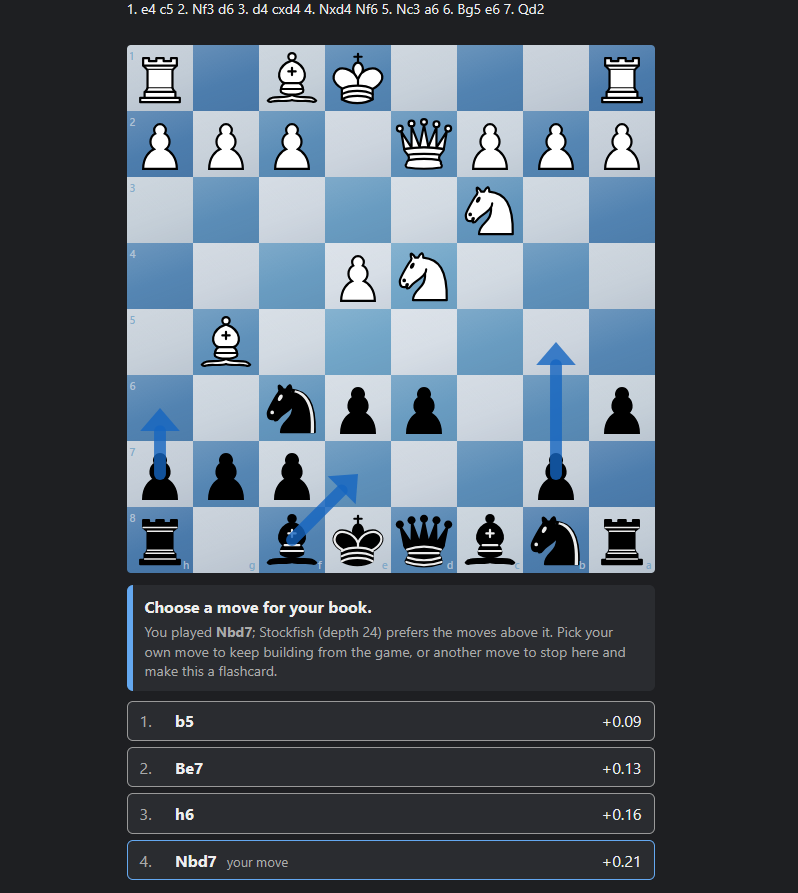
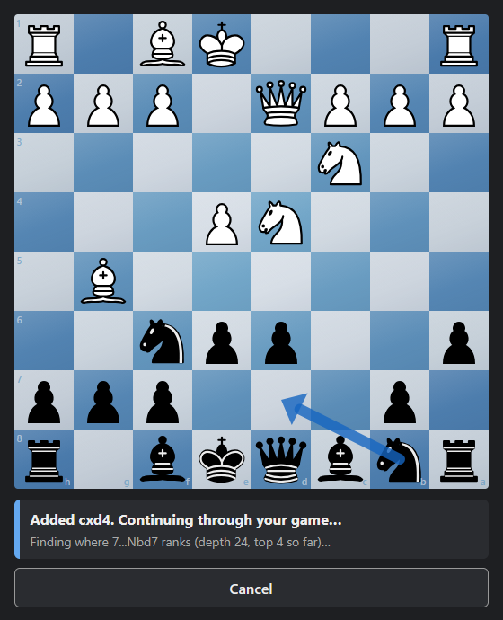
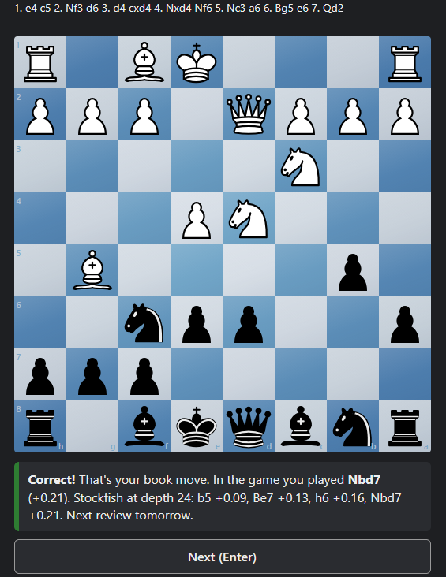
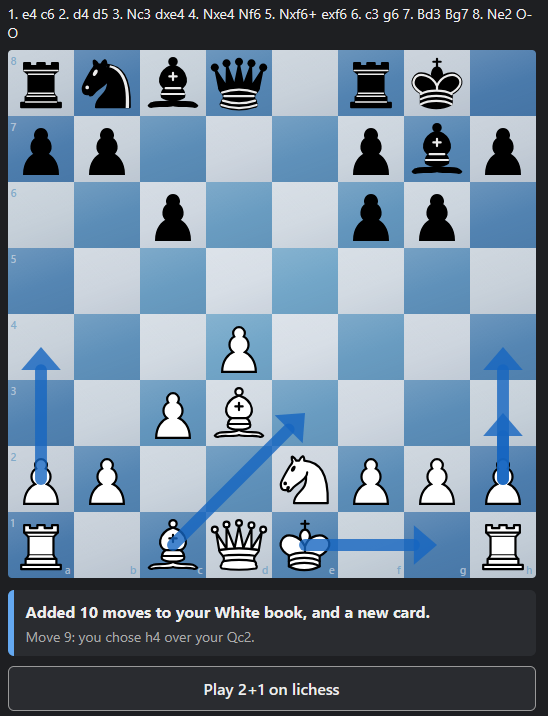
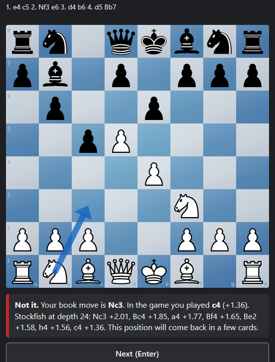
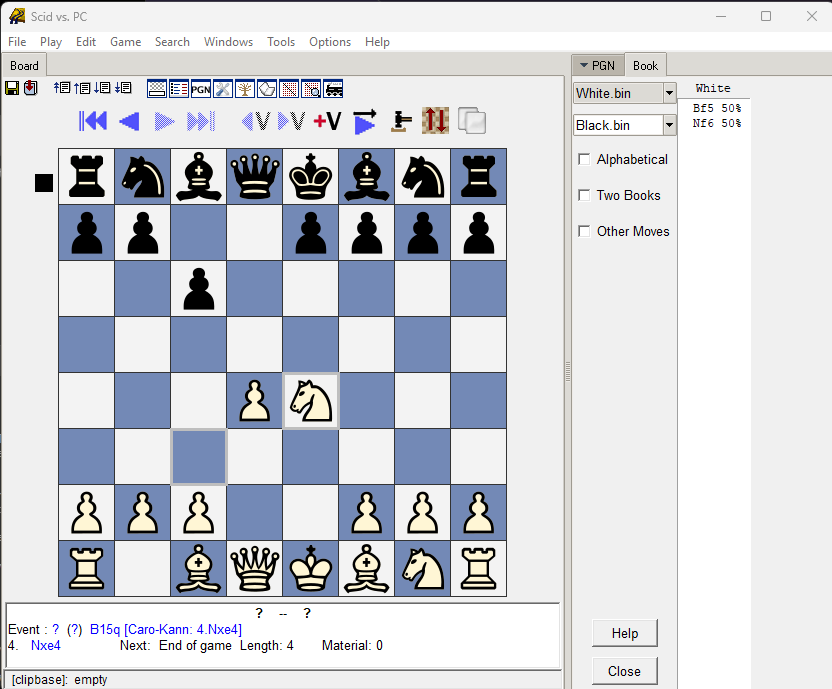

# Lichess Opening Trainer

Build your own opening repertoire from the games you actually play on lichess, then drill the positions where you chose a better move than the one you played.

- Play a game on lichess at the time control you pick.
- Afterwards, Stockfish walks through your moves. Wherever you played its best move, the move goes into your opening book automatically.
- Where you didn't, you see Stockfish's moves ranked down to yours and choose which one belongs in your book. Choose a different move from the one you played, and that position becomes a flashcard.
- Flashcards use spaced repetition. When you're done, it sends you into your next game.

Your books start empty and grow with every game. They're standard **Polyglot** `.bin` files, so you can also open and edit them in Scid or other chess programs.

## Screenshots

**Choosing a move for your book.** You played 7...Nbd7; Stockfish lists every move it ranks above yours.

| Analysis follows your game | Drilling the flashcard |
|---|---|
|  |  |
| **End of a game:** what was added to your book | **A miss:** your book move, and how your game move ranked |
|  |  |

## Download

**[Download the latest release](../../releases/latest)**: `Lichess.Opening.Trainer.zip` for Windows, or `Lichess.Opening.Trainer.Linux.tar.gz` for Linux. Both include Stockfish 19, so there's nothing else to download except Python.

### Windows

1. Install **Python 3** from https://www.python.org/downloads/ (about a 30 MB download). During setup, tick **"Add python.exe to PATH"**.
2. **Extract the zip** anywhere: right-click it and choose *Extract All…*. Don't run the trainer from inside the zip; it can't find its files there.
3. Log in to **lichess.org** in your default browser. You play your games there as usual.
4. Double-click **`OpeningTrainer.bat`**. The first time, it installs the `python-chess` package. A console window opens (leave it open; closing it stops the trainer), and the trainer opens in your browser at http://localhost:8767.
5. Enter your lichess username. No password or API token is needed; the trainer only reads your public games through the lichess API.

### Linux

1. Make sure **Python 3** is installed (it usually is; otherwise `sudo apt install python3 python3-venv`, or your distribution's equivalent).
2. Unpack the download anywhere: `tar xzf Lichess.Opening.Trainer.Linux.tar.gz`
3. Log in to **lichess.org** in your default browser.
4. Run `./OpeningTrainer.sh` in the unpacked `Lichess Opening Trainer` folder. The first time, it installs `python-chess` into a private `.venv` folder there. Leave the terminal open (Ctrl+C stops the trainer); the trainer opens in your browser at http://localhost:8767.
5. Enter your lichess username.

To use a Stockfish installed on your system instead (for example `sudo apt install stockfish`), delete the bundled `stockfish` folder; the trainer then uses the `stockfish` command.

## How it works

1. Pick a **time control** and an **analysis depth** at the top of the page, then press **Play**. Lichess opens and joins the quick-pairing pool for that time control.
2. When the game ends, your moves are walked in order against your book (White or Black, depending on your color). The board shows each position as it's checked.
   - **Your move is in your book:** keep going.
   - **It isn't, and it's Stockfish's best move** at the chosen depth: it's added to your book, along with your opponent's move before it, and the walk keeps going.
   - **Otherwise you choose.** It asks Stockfish for its best move, then its best 2, 3, … at the same depth until your move appears, and lists them in order with their evaluations. The same happens if the position is already in your book and you played something else.
     - **Pick your own move:** it's added and the walk keeps going.
     - **Pick a different move:** that move goes in your book, the walk stops there, and the position becomes a **flashcard**.
3. **Drill your flashcards.** A missed card comes back 5 cards later. Each correct answer in a row pushes the next review further out: 1 day, 3 days, 1 week, 2 weeks, 1 month, 2 months, 4 months, then doubling. The correct answer is whatever your book plays there, so edits you make in Scid count too. When there are no cards left to do, the trainer sends you into your next game.

A higher analysis depth gives more reliable evaluations but a longer wait after each game. 24 is a good default. Book moves aren't analyzed, so the wait shrinks as your book grows.

## Your files

These are created next to `trainer.py` on first run. They're yours, and they're ignored by git:

| File | What it holds |
|---|---|
| `White.bin`, `Black.bin` | Your opening books (Polyglot) |
| `progress.json` | Flashcards and review history |
| `config.json` | Username, time control and depth |

To start over, close the trainer and delete them.

Because the books are plain Polyglot files, other chess programs can read them. Here's `White.bin` open in Scid vs. PC:

## Running from source

The repository doesn't include Stockfish, because the exe is over GitHub's 100 MB file limit. To run from a clone:

1. Get Stockfish: download it from https://stockfishchess.org/download/ and put the program in a folder named `stockfish` next to `trainer.py` (any build works; the trainer uses whichever `stockfish*` program it finds there), or install it so the `stockfish` command works.
2. On Windows, run `pip install chess`, then `python trainer.py`. On Linux, run `./OpeningTrainer.sh`.

## Requirements

- Windows or Linux, Python 3, and a lichess account.
- The bundled Stockfish 19 is the universal x86-64 build, which picks the fastest code for your CPU, so it runs on any 64-bit Intel or AMD PC.

## License

GPLv3. See [LICENSE](LICENSE). Credits for Stockfish, python-chess and the piece set are in [CREDITS.md](CREDITS.md). This project isn't affiliated with lichess.org.
